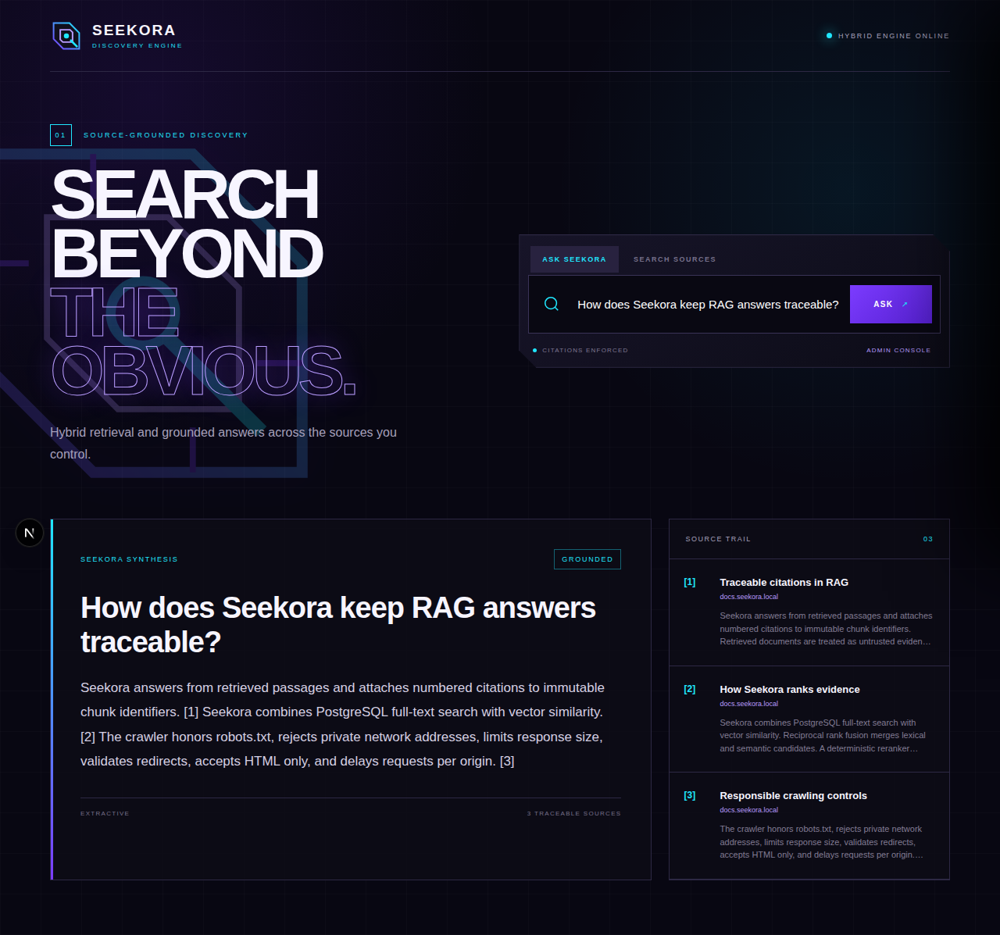
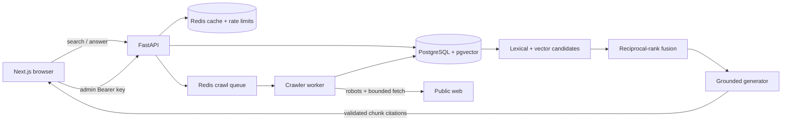

<div align="center">
  

# SEEKORA

**Search beyond the obvious.**

Self-hosted hybrid retrieval and grounded answers with traceable source citations.
</div>



Seekora is a production-oriented MVP built with Python 3.12, FastAPI, PostgreSQL 16 + pgvector, Redis, Next.js, TypeScript, Docker Compose, pytest, and Playwright. It can crawl or directly ingest documents, combine PostgreSQL full-text and vector retrieval, produce grounded answers, and preserve a source trail down to immutable chunk identifiers. The deterministic local path has no paid dependency; an OpenAI-compatible answer provider is optional.

## What is implemented

| Capability | Status | Evidence / limitation |
|---|---|---|
| URL crawling and `robots.txt` | Implemented, unit-tested | Public HTTP(S) only, per-origin delay, bounded redirects/body/time, HTML-only. |
| Parsing and deduplication | Implemented, unit-tested | Main-content extraction and exact SHA-256 content deduplication. |
| Full-text retrieval | Implemented | PostgreSQL `tsvector` + GIN and `ts_rank_cd`; BM25-style, not exact BM25. |
| Vector retrieval | Implemented | pgvector HNSW cosine index; default vectors use a deterministic free hashing baseline. |
| Hybrid ranking | Implemented, relevance fixtures pass | Lexical/vector candidate sets + reciprocal-rank fusion + transparent term coverage. |
| RAG answers and citations | Implemented, tested end to end | Local extractive default; optional OpenAI-compatible chat completion with citation validation and local fallback. |
| Prompt-injection boundary | Implemented, unit-tested | Retrieved text is untrusted; unsafe evidence phrases are excluded and generated references are validated. |
| Authentication | Implemented, authorization-tested | Single-administrator API key. OIDC/multi-user roles are not claimed. |
| API limiting and caching | Implemented, unit-tested | Redis counters and two-minute search cache; process-local limiter fallback. |
| Crawl queue and worker | Implemented, queue lifecycle-tested | Redis list + status records; Compose worker consumes jobs. |
| Analytics and administration | Implemented | Query/result/latency events, stats API, and authenticated UI console. |
| Frontend | Implemented, production build + real Playwright pass | Responsive purple/cyan interface with original SVG identity. |
| PostgreSQL/Redis runtime | Configured; CI workflow included | Not run on the authoring host because Docker/PostgreSQL/Redis are unavailable. |

## Architecture



The browser initiates a query, FastAPI retrieves lexical and vector candidates, fusion produces one ranked evidence set, and the answer service accepts only citations that resolve to that set. PostgreSQL is authoritative; Redis state is disposable. See [ARCHITECTURE.md](ARCHITECTURE.md) and [AUDIT.md](AUDIT.md).

## Quick start with Docker Compose

Requirements: Docker Engine with Compose v2.

```bash
cp .env.example .env
# Replace SEEKORA_ADMIN_API_KEY in .env before any shared deployment.
docker compose up --build
```

Open [http://localhost:3000](http://localhost:3000). The one-shot migration and seed services create the schema and add three reference documents. Development API docs are at [http://localhost:8000/docs](http://localhost:8000/docs).

### Reproducible demonstration

1. Open **Admin console** in the application.
2. Enter the value of `SEEKORA_ADMIN_API_KEY`.
3. Select **Ingest demo corpus**.
4. Ask: `How does Seekora keep RAG answers traceable?`
5. Confirm the answer is marked **Grounded**, then open each numbered source.

The same story is automated without network mocks:

```bash
make demo-test
```

Playwright starts the real FastAPI application in explicit in-memory demo mode, starts Next.js, authenticates, ingests the corpus through `/v1/documents/text`, calls `/v1/answer`, checks attribution, and writes the screenshot shown above.

## API examples

Set the local administrator key:

```bash
export SEEKORA_DEMO_KEY='the-value-from-your-env-file'
```

Queue a public URL for the Redis worker:

```bash
curl -X POST http://localhost:8000/v1/crawl/jobs \
  -H "Authorization: Bearer $SEEKORA_DEMO_KEY" \
  -H 'Content-Type: application/json' \
  -d '{"url":"https://example.com/"}'
```

Directly ingest trusted text:

```bash
curl -X POST http://localhost:8000/v1/documents/text \
  -H "Authorization: Bearer $SEEKORA_DEMO_KEY" \
  -H 'Content-Type: application/json' \
  -d '{"url":"https://docs.example.test/guide","title":"Example guide","content":"Hybrid retrieval combines lexical and vector search."}'
```

Search and answer:

```bash
curl 'http://localhost:8000/v1/search?q=hybrid%20retrieval'

curl -X POST http://localhost:8000/v1/answer \
  -H 'Content-Type: application/json' \
  -d '{"query":"How does hybrid retrieval work?"}'
```

Each answer citation includes `index`, `chunk_id`, `document_id`, title, URL, and the supporting quote.

## Host development

```bash
python3.12 -m venv .venv
.venv/bin/pip install -e 'backend[dev]'
cd frontend && npm ci && npx playwright install chromium && cd ..
```

Run checks:

```bash
make test
```

Run the services without Docker in deterministic demo mode:

```bash
SEEKORA_DEMO_MODE=true \
SEEKORA_RATE_LIMIT_ENABLED=false \
SEEKORA_ADMIN_API_KEY=seekora-local-key \
SEEKORA_CORS_ORIGINS=http://localhost:3000 \
.venv/bin/uvicorn app.main:app --app-dir backend --reload

cd frontend
NEXT_PUBLIC_API_URL=http://localhost:8000 npm run dev
```

Demo mode is intentionally explicit and in-memory. It proves the application story but does not replace PostgreSQL/Redis deployment verification.

## Optional model provider

The default `extractive` provider is deterministic, local, and free. To use a compatible chat-completions service:

```env
SEEKORA_RAG_PROVIDER=openai-compatible
SEEKORA_RAG_MODEL=your-model-name
SEEKORA_RAG_BASE_URL=https://provider.example/v1
SEEKORA_RAG_API_KEY=secret
```

Only final retrieved passages are sent. If the provider fails or returns missing/out-of-range citations, Seekora falls back to local extractive generation. Paid services are never required for setup, tests, crawling, indexing, retrieval, or answers.

## Configuration

All backend variables use the `SEEKORA_` prefix. Important values are documented in [.env.example](.env.example): database and Redis URLs, CORS origins, crawler identity/limits, administrator key, API limit, demo mode, answer source count, and optional provider settings. `NEXT_PUBLIC_API_URL` is public and embedded into the frontend build; never place secrets in a `NEXT_PUBLIC_` variable.

## Security and operations

Read [docs/SECURITY.md](docs/SECURITY.md) before exposing Seekora to a network. Highlights:

- Crawled text is untrusted and cannot authorize actions.
- Private-network targets and cross-origin redirects are rejected.
- Corpus writes, crawl jobs, and admin statistics require the administrator key.
- Production refuses the documented development key.
- Search analytics may contain sensitive query text; set retention appropriately.
- Run migrations as a release task and back up PostgreSQL with point-in-time recovery.

## Tests and evidence

The suite covers parser failures, URL policy, robots denial, body and redirect limits, authorization, API contracts, cache/queue/limit behavior, deterministic embeddings, fusion, relevance fixtures, citation integrity, injection resilience, and a complete API story. The Playwright test is not API-mocked.

Current authoring-host results are recorded in [COMPLETION_REPORT.md](COMPLETION_REPORT.md). The repository also includes [.github/workflows/ci.yml](.github/workflows/ci.yml), which provisions PostgreSQL/pgvector and Redis for the backend job and runs the full browser story separately.

## Release

Follow [docs/RELEASE_CHECKLIST.md](docs/RELEASE_CHECKLIST.md). Do not call a release production-ready until Compose has been run on a Docker-capable host, the live PostgreSQL test passes, citations have been manually opened, production secrets are rotated, and restore procedures are rehearsed.

## License

No license has been selected. Add one before public redistribution.
